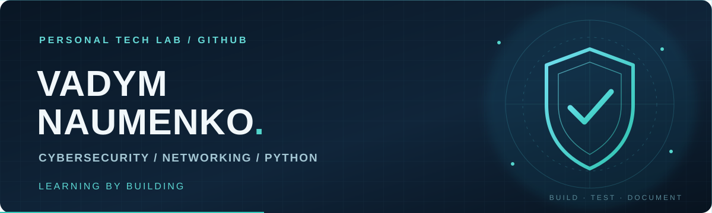

  

  <strong>From networking fundamentals to practical security tooling.</strong> 
  Hands-on labs, Python scripts, and clear technical notes — one project at a time.

  
  

## 👋 About me

I'm Vadym, developing practical skills in **cybersecurity, computer networking, and Python automation**. I use GitHub as a personal technical lab: a place to share working exercises, document what I learn, and improve projects over time.

**My approach:** `LEARN` → `BUILD` → `TEST` → `DOCUMENT` → `IMPROVE`

## 🧰 Skills & lab toolkit

**Programming & developer tools**

**Networking & security labs**

*These are technologies I work with or explore in learning environments — not a claim of expert-level proficiency.*

## 🛡️ Featured project

### [PythonNetworkFilter](https://github.com/Vadym0048/PythonNetworkFilter)

A small educational Python toolkit for understanding network activity and basic security-related log analysis.

| Lab | What it demonstrates |
| :-- | :-- |
| **01 · Connection analysis** | Counts `CONNECT` events by IP address |
| **02 · Device configuration** | Reads device settings and performs a basic subnet-prefix check |
| **03 · Firewall analysis** | Summarizes `ALLOW` / `DENY` events and flags repeated denials |

**Built with:** Python standard library · sample log files · text reports

[**Explore source code and documentation →**](https://github.com/Vadym0048/PythonNetworkFilter)

## 🧭 What I'm learning

| Focus | Hands-on direction |
| :-- | :-- |
| **Network engineering** | TCP/IP, subnetting, routing, switching, Cisco labs |
| **Security monitoring** | Network events, firewall logs, alert logic |
| **Python automation** | File processing, reusable scripts, reports |
| **Systems & infrastructure** | Linux, Windows Server, virtualized lab environments |

## 📓 Lab notes

I keep projects intentionally practical. Each repository aims to explain **what it does, how to run it, what I learned, and what could improve next**. Educational demonstrations are labeled as such rather than presented as production security tools.

---

  <strong>Learning by Building.</strong> 
  Build · Test · Document · Improve

